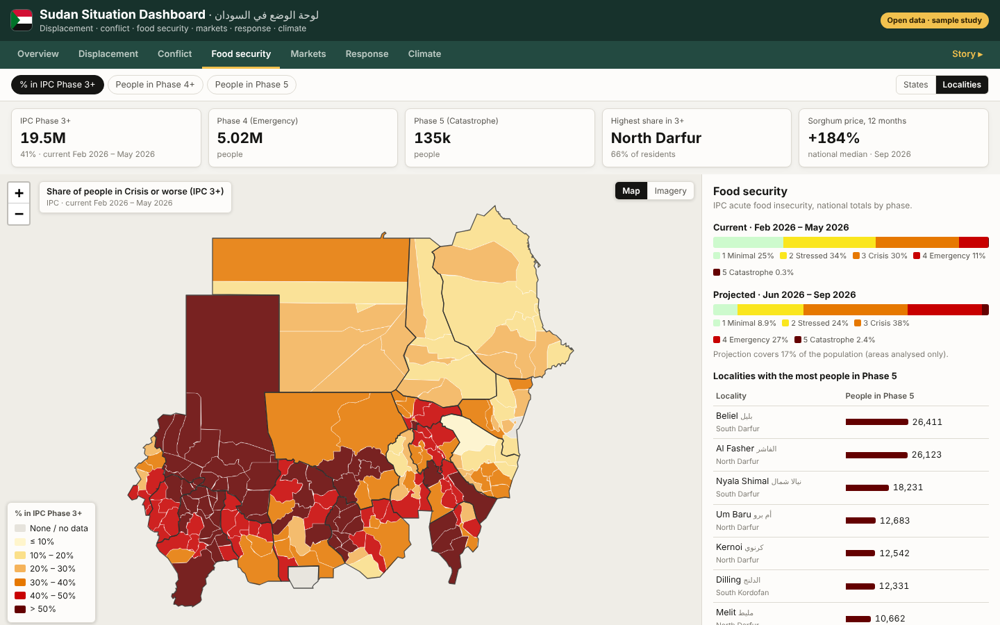

# Sudan Humanitarian Data Explorer · مستكشف البيانات الإنسانية للسودان

A personal sample study: an interactive dashboard that brings together the main **open humanitarian datasets for Sudan** in one place, by **state and locality**: displacement, conflict, food security, market prices, humanitarian response and rainfall. All data comes from public sources on the Humanitarian Data Exchange (HDX), refreshes automatically every week, and every number on screen is computed from the source files.

> 📘 **Personal sample study.** Built by Amna Abdein as a learning and portfolio project. It is **not an official product** of IOM, OCHA, WFP, IPC, ACLED, UNHCR or any other organisation. Figures are as published by each source and carry their own caveats.

**Live dashboard:** https://aelsayied-create.github.io/sudan-situation-dashboard/



## What's inside
| Tab | Map indicators | Charts & tables |
|---|---|---|
| **Overview** | IDPs, fatalities, IPC 3+, returnees, partners | Sudan at a glance, IDP trend, refugees by country of asylum |
| **Displacement** | IDPs hosted, IDPs per 1,000 residents, state of origin, returnees + **flow lines** (origin → destination) | IDP trend, largest movements, hosted vs originating |
| **Conflict** | Fatalities and events (12 months, since April 2023) | Monthly events & fatalities, civilian targeting, top localities |
| **Food security** | % in IPC Phase 3+, people in Phase 4+ and Phase 5 | Phase distribution (current & projected), Phase 5 localities, sorghum price |
| **Markets** | WFP markets coloured by 12-month price change (stale markets flagged) | National median prices, change by commodity, market table |
| **Response** | Partners per state/locality (sector filter), **IDPs per partner** (coverage gaps) | Appeal requirements vs funding since 2014, partners by sector |
| **Climate** | Rainfall % of long-term average with month slider | State × month anomaly calendar, rainfall vs average |
| **Story** | Seven guided steps | Data-driven narrative from displacement to the response gap |

Click any state or locality for a **profile** (English and Arabic names) with all indicators, IPC phase bar, monthly conflict, IDP trend, rainfall and partners by sector.

## Architecture
```
scripts/fetch_data.py   ingestion (GitHub Actions, weekly): HDX HAPI, OCHA COD-AB, UNFPA COD-PS,
                        IOM DTM snapshot, WFP prices  ->  data/raw/  (versioned)
scripts/build_data.py   processing (standard library only): aggregation by state/locality,
                        IPC periods, ACLED 12-month windows, market changes, flows -> web/data/
tests/                  pytest checks (date helpers, data consistency)
web/                    static front end (Leaflet, Chart.js, vanilla JS, no build step)
.github/workflows/      refresh-data.yml (weekly fetch) -> pages.yml (build, test, deploy)
```

## Run locally
```bash
python scripts/build_data.py                 # uses the committed data/raw/
cd web && python -m http.server 8000         # open http://localhost:8000
# refresh the raw data: pip install shapely openpyxl && python scripts/fetch_data.py
```

## Data sources (all via HDX)
- **IDPs & returnees:** IOM Displacement Tracking Matrix (HDX HAPI; DTM master list snapshot for origin–destination)
- **Conflict:** ACLED monthly aggregates by locality (HDX HAPI). Fatalities are taken from the political violence series only, to avoid double counting civilian targeting.
- **Food security:** Integrated Food Security Phase Classification (IPC), via HDX HAPI
- **Market prices:** WFP Market Monitor (retail prices, SDG)
- **Operational presence (3W), humanitarian needs, boundaries:** OCHA Sudan, OCHA FISS COD-AB
- **Funding:** OCHA Financial Tracking Service, via HDX HAPI
- **Population:** UNFPA COD-PS
- **Refugees:** UNHCR, via HDX HAPI
- **Rainfall:** CHIRPS, processed by WFP, via HDX HAPI
- **Risk:** INFORM Risk Index, via HDX HAPI
- Basemaps: Esri World Light Gray Canvas & World Imagery, © OpenStreetMap contributors

Each source keeps its own licence (mostly CC BY / CC BY-IGO); see `data/raw/SOURCES.json` for the exact dataset, resource and update date used.

## Method notes
- The IPC projection may cover only part of the population; the dashboard says so when coverage is below 90%.
- Markets without a price in the last six months are shown as hollow circles and excluded from "most expensive" figures (often besieged or inaccessible markets).
- Rainfall anomalies are hidden in months whose long-term average is below 5 mm (dry season).
- "IDPs per partner" divides IOM DTM IDPs by the number of organisations reporting in the OCHA 3W; it is a rough coverage signal, not a measure of assistance delivered.

## Author
**Amna Abdein** — GIS Specialist & Geospatial Web Developer · [LinkedIn](https://www.linkedin.com/in/amna-abdein-0429a673)
